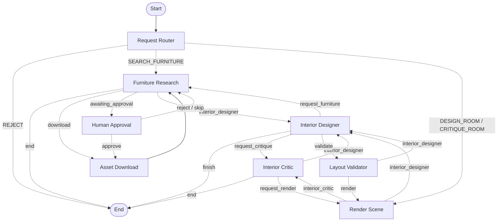

# RoomCraft agent graph

Generated from the compiled LangGraph (`from design.graph import mermaid`). Every node exists once;
dotted edges are conditional, labelled with the routing keys from `src/design/routing.py`.



## How control returns to the caller

Shared nodes do not know who called them; the caller writes its own name into `return_to`
before routing there:

| Shared node | Set by | `return_to[node]` | Missing entry means |
|---|---|---|---|
| `render_scene` | orchestrator, layout_validator, critic | `interior_designer` / `interior_critic` | bug (raises) |
| `interior_critic` | designer | `interior_designer` | standalone critique → END |
| `furniture_research` | designer | `interior_designer` | standalone search → END |

`asset_download → furniture_research` is a fixed edge: downloads only start there, the research
coordinator collects them (see "Furniture lists" below). `layout_validator` always ends at the designer,
either directly or through `render_scene` (see "Screenshots" below).

## Furniture lists (`furniture_research`, `human_approval`, `asset_download`)

The designer (`request_furniture`) and a direct user search (`SEARCH_FURNITURE`, the orchestrator
splits "a sofa and two lamps" into `furniture_items`) hand over a LIST in `furniture_request.items`
(description, purpose, size, style, colours/materials, essential). `furniture_research` is the
coordinator of that list; every item has an explicit state in `research_items`. The three nodes of a
list live in `src/research/` (`agent.py`, `human_approval.py`, `asset_download.py`), next to the jobs
they coordinate; the graph itself is assembled in `src/design/graph.py`.

```
pending ──(direct search only)──> searching_local ──> found_locally
   │                                    └──(no match)──┐
   └──(designer: no local search)──────────────────────┴─> searching_online (run 1)
searching_online ──> awaiting_approval (guided) ──approve──> downloading ──> completed | failed
                 │                               ├─reject (run 1)─> retrying ─> searching_online (run 2)
                 │                               ├─reject (run 2)─> rejected
                 │                               └─skip──────────> skipped
                 ├──> downloading (automatic: best suitable candidate)
                 ├──> found_locally (result already in the inventory)
                 └──> retrying (nothing suitable in run 1) | not_found (run 2) | failed (search error)
online search off ──> not_found
```

How the parallel work fits LangGraph:

- **LangGraph orchestrates, jobs do the slow work.** Local checks, online searches and downloads run
  as background jobs (`src/research/jobs.py`), keyed by run id and job key, at most
  `PARALLEL["research"]` (3) searches and `PARALLEL["downloads"]` (3) downloads at a time. Each MCP
  search opens its own MCP session, so parallel items never share one.
- **The state is the source of truth.** Only graph nodes change `research_items` (one node at a time,
  no concurrent updates); jobs only produce results. Each item records the job it waits for, so
  results may arrive in any order and are assigned to the right item; merging a result twice is a no-op.
- **interrupt() does not stop the jobs.** `human_approval` pauses for ONE item; the graph task ends,
  the jobs keep running. On resume the coordinator merges whatever finished meanwhile and shows the
  next ready item (by readiness, not list order). A job that disappeared (e.g. lost with its event
  loop) is started again under the same key; searches have no side effects and downloads are
  idempotent (`download:<asset id>`: an asset is downloaded at most once per run, also when two
  items chose it).
- **No approval blockade.** The coordinator pauses as soon as one item is ready, even while others
  are searched or downloaded; `reject` in run 1 starts run 2 for that item right away and the user
  continues with the next item. Only when nothing is ready does the coordinator wait for jobs
  (progress events every 0.5 s, `research_status` stage with counts per status and budget used).
- **Downloads start immediately.** `approve` → `asset_download` starts the jobs and returns at once;
  so does an automatic choice (`furniture_research → download → asset_download`).
- **The list is done** when every item has a final state and every started download has finished;
  then the result goes to the caller: `research_result.items` (one entry per item) plus the flat
  lists `added`, `existing`, `failed`, `local`. The designer sees one line per item with its `item_id`s.

Search settings (Design tab, stored in `options`, read via `routing.research_mode`):

| Mode | `search_online` / `review_suggestions` | Behaviour |
|---|---|---|
| local_only | off / – | direct search: furniture database only, nothing downloaded, the rest `not_found`; the designer starts no research (essential gaps become warnings) |
| guided (default) | on / on | up to 4 suggestions per item and run, the user approves, rejects (second run) or skips one item at a time |
| automatic | on / off | the agent ranks candidates; the first one that passes `auto_acceptable` (suitable, category ok, no failed check, known licence) is downloaded; nothing suitable in run 1 → run 2, then `not_found` |

`asset_download` only starts downloads that `download_authorized` allows: a candidate of the item's
current run selected by the user for that run, or an automatic choice while the options say
automatic. An LLM decision can never replace the user's approval in guided mode.

The local check (direct searches only) runs the local search first, then an LLM checks the best
matches against the item's essential requirements (`choose_local_item`); a match is only accepted
when every listed requirement is met (a category match alone is not enough). Local finds need no
approval, no download and no online budget. External results that are already in the inventory
(`alreadyInInventory`) count as local finds in both cases.

## Screenshots (`render_scene`)

The designer cannot request renders. Screenshots are made:

| Trigger (`render_trigger`) | Set by | When |
|---|---|---|
| `initial` | orchestrator | first look at the room (DESIGN_ROOM, CRITIQUE_ROOM) |
| `validation` | layout_validator | the validated layout is not `invalid`, the designer continues (no direct acceptance with `finish_when_valid`) and `working_layout.render_due`: no screenshots yet, a substantial change since the last ones (pieces added/removed or ≥ 2 moved/turned, same rule as the designer's "Screenshots vs. working layout" section) or screenshots ≥ `STALE_RENDER_VERSIONS` (2) versions old |
| `critic` | interior_critic | its screenshots do not show the layout it critiques |

Invalid layouts are not rendered: the repair works from the validator's numbers. Renders have no limit
(no LLM cost; bounded by validations and critiques). The validator's decision is the state value
`render_after_validation`, read by `routing.after_validator`.

Storage (`src/rendering/service.py`), relative to `src/data/renders/`:

```
cache/<sha256 key>/top.png, perspective.png      identical rooms are rendered once (all runs)
runs/<run_id>/<seq>_v<layout version>_<trigger>/  one folder per render of the run (cache hits are copied)
runs/<run_id>/manifest.json                       seq, folder, layoutVersion, trigger, cacheKey, cached, ts
```

The run id is the LangGraph thread id (= the run id of the API). `scene_images` holds
`renders/runs/<run_id>/<folder>/<view>.png`; the API serves them at `/api/renders/runs/<run_id>/<folder>/<file>`
(every segment checked against its format, nothing else is reachable). Renders outside a run go to `runs/_adhoc/`.

## Aborting a run

`DELETE /api/design/runs/{id}` (Abort run in the Design tab, the Overview and the approval panel) ends a
run for good; it is never resumed. A running task is cancelled (LLM, MCP, downloads, rendering stop at
their next await); a run waiting for approval is ended directly; a task cancelled before it started is
settled by its done callback. Every run ends with exactly one `workflow.cancelled`; repeated calls and
calls after the end are no-ops. Afterwards the run's bookkeeping and LangGraph checkpoint are discarded,
only its events remain. Completed and failed runs drop their checkpoint as well (only a paused run needs
it); their result and events stay on the run. Nothing of the run is applied to the room; furniture downloaded before the abort
stays in the inventory (the frontend reloads it).

Background research jobs end with the run: every way a run ends (abort while running or waiting,
completion, failure) calls `research.jobs.close(run_id)`, which cancels the running searches and
downloads and refuses new jobs (a download waiting for a free slot does not start). Finished
downloads are untouched; late results are dropped with the job registry and can never resume the
run, which is discarded anyway.

## State (`src/design/state.py`)

| Group | Fields | Written by | Notes |
|---|---|---|---|
| Input | `request`, `model`, `room`, `furniture`, `preferences` | API | never changed; `furniture` is the confirmed room |
| | `models` | API | model per agent (`orchestrator`, `interior_designer`, `interior_critic`, `furniture_research`); read via `state.model_for`, missing agents use `model`. API defaults: designer = `OPENROUTER_MODEL`, all others = `OPENROUTER_HELPER_MODEL` (gpt-5-mini) |
| | `options` | API | `allow_new_furniture`, `allow_removal`, `final_review`, `search_online`, `review_suggestions`, `limits` (the user's max. iterations = `designer_steps`, max. furniture lists = `research_requests`) |
| Control | `intent`, `security_flags` | orchestrator | |
| | `return_to` | callers of shared nodes | reducer: keys are merged |
| | `counters` | every agent node | reducer: values are added; limits in `routing.LIMITS` |
| | `workflow_log` | most nodes | reducer: appended; short history the agents read |
| | `outcome` | the node that ends the run | `{status: completed / failed / rejected, kind, message}` |
| Render | `scene_images`, `rendered_layout_version`, `rendered_layout` | render_scene | image paths only, never image data |
| | `render_trigger` | orchestrator, validator, critic | `initial` / `validation` / `critic`; part of the render folder name |
| | `render_after_validation` | validator | render the validated layout before the designer continues |
| Designer | `proposed_layout`, `layout_version`, `designer_action`, `finish_when_valid`, `explanation` | designer, validator (corrections) | temporary layout: the complete list of pieces in the proposed room (moved, kept, added from the inventory with ids `new-…`); missing confirmed pieces are removed |
| | `furniture_gaps` | designer | completeness check of the latest step; essential gaps trigger research or end up in `warnings` / `missing` |
| | `researched` | designer | descriptions of all requested list items of the run, one each (reducer: appended); a gap is researched automatically at most once (also when skipped) |
| | `design_plan` | designer | functional plan (requirements, zones with anchor/pieces/arrangement/missing, composition) from the designer's latest planning step; shown to the designer in later steps (with plan-vs-layout hints) and to the critic |
| Validator | `validation`, `validated_layout_version`, `repair_history` (appended) | validator | corrections are applied even if errors remain; errors carry severity and repair options |
| Designer repair | `repair_strategy` | designer | copied into the next `repair_history` entry |
| Critic | `critique`, `critiqued_layout_version`, `critic_action` | critic | |
| | `reviewed_layout` | designer | snapshot of the validated layout sent to the final review; the result if later changes fail |
| | `critic_research_bonus` | critic | set once per run (see "Loop protection") |
| Research | `furniture_request` | designer, orchestrator | the list: `items` + shared `style`, `budget` |
| | `research_items` | research, approval, download | one persistent entry per item: status, run, job, candidates, selection, downloads, local finds |
| | `research_batch`, `research_status`, `approval_item` | research, approval, download | list id / online flag; `""` (new list), `active`, `awaiting_approval`, `download`, `done`; the item shown to the user |
| | `approval`, `download_result`, `research_result` | approval, research | last decision; downloads merged in the latest research step (the runner collects `added`); final result for the caller |
| Result | `layout`, `removed`, `warnings`, `message` | designer | `layout` (all pieces) and `removed` are set only for a validated layout |

## Adding and removing furniture

Per request the user decides (Design tab):

- **Include more furniture** (`allow_new_furniture`): the designer sees all placeable inventory items
  (with measured size, scaled by `unitScale`) and may place them, also several times; with the online
  search on it may also request furniture research (one list of all missing pieces). New pieces are
  validated like the rest and become new scene instances when applied.
- **Search furniture online** (`search_online`, default on) and **Let me review furniture suggestions**
  (`review_suggestions`, default on, only with the online search): see "Furniture lists" above.
- **Allow removing furniture** (`allow_removal`): the designer may take pieces of the room out.
  Pieces it added during the run may always be removed again.
- **Final review by the critic** (`final_review`, default on): when the designer finishes with a validated
  layout and the run had no critique yet, the guard sends that layout to the critic once (only if a
  critique, a designer step and a validation are still left). The designer gets one more step to act on
  the feedback or finish. The reviewed layout is stored in `reviewed_layout`; if the changes after the
  review fail (validation or step limit), the run completes with the reviewed layout plus a warning.
- **Max. iterations**: limit for designer steps (1–15) = LLM calls of the interior designer. Validations,
  renders, critiques and research do not count, but the designer needs a step to react to each.
- **Furniture lists** (`research_requests`, 0–5, default 2): the designer's lists that went online;
  a list whose pieces were all handled without an online search does not count. A list holds at most
  `MAX_ITEMS_PER_REQUEST` (6) pieces, so this also bounds the pieces searched online; there is no
  separate per-piece budget.

Changes that break these rules are skipped by the designer node (not by the LLM) and reported back
in the workflow log.

Missing furniture: in every step the designer reports `furniture_gaps` (essential or optional) for
the layout after its changes. Research is possible when adding is allowed, the online search is on,
a furniture list is left and a designer step remains to place the result (`research_blocker`);
the designer's context states whether it is. The designer requests all missing pieces in one list
(essential first) and rearranges the rest of the room in the same step. `_unresearched_essential`
collects every essential gap not researched yet in this run (`researched`): they are merged into the
designer's list, or, if the designer wants to finish, the guard starts a list with them instead.
Skipped or rejected pieces are never researched again automatically. Essential gaps that remain when
the run finishes become `warnings` and the result's `missing` list; the Design tab shows them with a
button that starts a furniture search.
The designer also sees each piece's category from the furniture database (rug, lamp, shelf, ...).

## Positions and vertical placement

Positions are `x`, `y`, `z` in metres: `x`/`z` the centre of the footprint (room centred on (0, 0)),
`y` the height of the BOTTOM of the bounding box above the floor (0 = on the floor; missing `y` = 0).
The frontend shifts every model so its lowest point is the instance origin, so the same `y` means the
same thing in the app, the renderer and the backend. Rotation stays the rotation around Y.

The validator (`src/design/validator.py`) is a permissive safety net, configurable in `ValidatorConfig`:
- collision = footprints overlap by more than 1 cm AND height ranges overlap by more than 3 cm
  (rugs under furniture, things on top, wall pieces above furniture never collide);
- a piece more than 5 cm above the floor must stand on another piece (bottom within 5 cm of its top,
  centre on its footprint, supporting footprint at least half as large) or touch an existing wall
  (`room.walls`; none given = all four sides), otherwise it is `unsupported`;
- nothing may reach below the floor or above the ceiling;
- small errors are corrected (≤ 15 cm), floating pieces by lowering them onto the surface below;
- pieces without a known height keep the former 2D check (they block their whole footprint).

Layout versions: 0 is the confirmed room; every designer change or automatic correction increases
`layout_version`. Render, validation and critique record the version they worked on, so the designer
can only finish with `validated_layout_version == layout_version`, renders happen only when the
layout changed, and the same version is not critiqued twice.

## Loop protection (`routing.LIMITS`)

| Counter | Limit | When reached |
|---|---|---|
| `designer_steps` | 8 | finish with the validated layout, otherwise fail |
| `validations` | 4 | fail (an invalid layout is never accepted) |
| `critiques` | 2 | requests are redirected |
| `research_requests` | 2 | further designer lists are redirected (counted when a list's first item goes online) |

With a critique that has issues or suggestions, the critic grants once per run `critic_research_bonus`
(only with "Include more furniture" and the online search): `routing.limit()` then adds
`CRITIC_BONUS` (+1 `research_requests`, i.e. one more list of up to 6 pieces). The global
`LIMITS` never change. The designer is told to request furniture only for pieces that resolve
concrete points of the critique; `research_blocker` still requires a designer step to place them.

Technical limits of the research (`src/research/agent.py`, not user settings):
`MAX_ITEMS_PER_REQUEST` 6 (`src/design/routing.py`; longer lists are cut and logged), `MAX_ONLINE_RUNS_PER_ITEM` 2,
`MAX_SUGGESTIONS_PER_ITEM` 4, `MAX_LLM_STEPS_PER_ITEM` 3 and `MAX_IMAGE_CHECKS_PER_ITEM` 6 per
online run, `PARALLEL` (`src/design/routing.py`) 3 searches and 3 downloads at a time. The runner
sets LangGraph's `recursion_limit` to 200 so that lists with several approvals and downloads fit;
every loop is still bounded by the limits above.

Renders have no limit (see "Screenshots"): they cost time, not LLM calls.

When the designer picks an action that is not allowed (limit reached, layout already rendered or
critiqued, finish without validation), a deterministic guard replaces it: validate an unvalidated
layout if possible, otherwise finish or fail.
