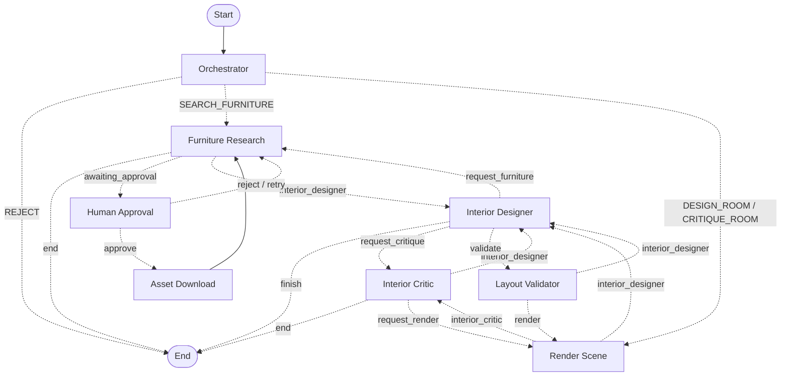

# RoomCraft agent graph

Generated from the compiled LangGraph (`from design.graph import mermaid`). Every node exists once;
dotted edges are conditional, labelled with the routing keys from `src/design/routing.py`.



## How control returns to the caller

Shared nodes do not know who called them; the caller writes its own name into `return_to`
before routing there:

| Shared node | Set by | `return_to[node]` | Missing entry means |
|---|---|---|---|
| `render_scene` | orchestrator, layout_validator, critic | `interior_designer` / `interior_critic` | bug (raises) |
| `interior_critic` | designer | `interior_designer` | standalone critique → END |
| `furniture_research` | designer | `interior_designer` | standalone search → END |

`asset_download → furniture_research` is a fixed edge. `layout_validator` always ends at the designer,
either directly or through `render_scene` (see "Screenshots" below).

## Screenshots (`render_scene`)

The designer cannot request renders. Screenshots are made:

| Trigger (`render_trigger`) | Set by | When |
|---|---|---|
| `initial` | orchestrator | first look at the room (DESIGN_ROOM, CRITIQUE_ROOM) |
| `validation` | layout_validator | the validated layout is not `invalid`, the designer continues (no direct acceptance with `finish_when_valid`) and `working_layout.render_due`: no screenshots yet, a substantial change since the last ones (pieces added/removed or ≥ 2 moved/turned, same rule as the designer's "Screenshots vs. working layout" section) or screenshots ≥ `STALE_RENDER_VERSIONS` (2) versions old |
| `critic` | interior_critic | its screenshots do not show the layout it critiques |

Invalid layouts are not rendered: the repair works from the validator's numbers. Renders have no limit
(no LLM cost; bounded by validations and critiques). The validator's decision is the state value
`render_after_validation`, read by `routing.after_validator`.

Storage (`src/rendering/service.py`), relative to `src/data/renders/`:

```
cache/<sha256 key>/top.png, perspective.png      identical rooms are rendered once (all runs)
runs/<run_id>/<seq>_v<layout version>_<trigger>/  one folder per render of the run (cache hits are copied)
runs/<run_id>/manifest.json                       seq, folder, layoutVersion, trigger, cacheKey, cached, ts
```

The run id is the LangGraph thread id (= the run id of the API). `scene_images` holds
`renders/runs/<run_id>/<folder>/<view>.png`; the API serves them at `/api/renders/runs/<run_id>/<folder>/<file>`
(every segment checked against its format, nothing else is reachable). Renders outside a run go to `runs/_adhoc/`.

## Aborting a run

`DELETE /api/design/runs/{id}` (Abort run in the Design tab, the Overview and the approval panel) ends a
run for good; it is never resumed. A running task is cancelled (LLM, MCP, downloads, rendering stop at
their next await); a run waiting for approval is ended directly; a task cancelled before it started is
settled by its done callback. Every run ends with exactly one `workflow.cancelled`; repeated calls and
calls after the end are no-ops. Afterwards the run's bookkeeping and LangGraph checkpoint are discarded,
only its events remain. Nothing of the run is applied to the room; furniture downloaded before the abort
stays in the inventory (the frontend reloads it).

## State (`src/design/state.py`)

| Group | Fields | Written by | Notes |
|---|---|---|---|
| Input | `request`, `model`, `room`, `furniture`, `preferences` | API | never changed; `furniture` is the confirmed room |
| | `models` | API | model per agent (`orchestrator`, `interior_designer`, `interior_critic`, `furniture_research`); read via `state.model_for`, missing agents use `model`. API defaults: designer = `OPENROUTER_MODEL`, all others = `OPENROUTER_HELPER_MODEL` (gpt-5-mini) |
| | `options` | API | `allow_new_furniture`, `allow_removal`, `final_review`, `limits` (the user's max. iterations = `designer_steps`, max. furniture searches = `research_requests`) |
| Control | `intent`, `security_flags` | orchestrator | |
| | `return_to` | callers of shared nodes | reducer: keys are merged |
| | `counters` | every agent node | reducer: values are added; limits in `routing.LIMITS` |
| | `workflow_log` | most nodes | reducer: appended; short history the agents read |
| | `outcome` | the node that ends the run | `{status: completed / failed / rejected, kind, message}` |
| Render | `scene_images`, `rendered_layout_version`, `rendered_layout` | render_scene | image paths only, never image data |
| | `render_trigger` | orchestrator, validator, critic | `initial` / `validation` / `critic`; part of the render folder name |
| | `render_after_validation` | validator | render the validated layout before the designer continues |
| Designer | `proposed_layout`, `layout_version`, `designer_action`, `finish_when_valid`, `explanation` | designer, validator (corrections) | temporary layout: the complete list of pieces in the proposed room (moved, kept, added from the inventory with ids `new-…`); missing confirmed pieces are removed |
| | `furniture_gaps` | designer | completeness check of the latest step; essential gaps trigger research or end up in `warnings` / `missing` |
| | `researched` | designer | descriptions of all furniture requests of the run (reducer: appended); a gap is researched once |
| | `design_plan` | designer | functional plan (requirements, zones with anchor/pieces/arrangement/missing, composition) from the designer's latest planning step; shown to the designer in later steps (with plan-vs-layout hints) and to the critic |
| Validator | `validation`, `validated_layout_version`, `repair_history` (appended) | validator | corrections are applied even if errors remain; errors carry severity and repair options |
| Designer repair | `repair_strategy` | designer | copied into the next `repair_history` entry |
| Critic | `critique`, `critiqued_layout_version`, `critic_action` | critic | |
| | `reviewed_layout` | designer | snapshot of the validated layout sent to the final review; the result if later changes fail |
| Research | `furniture_request`, `research_round`, `research_status`, `research_summary`, `candidates`, `rejected_asset_ids`, `approval`, `download_result`, `research_result` | research, approval, download | `approval` / `download_result` are cleared once consumed |
| Result | `layout`, `removed`, `warnings`, `message` | designer | `layout` (all pieces) and `removed` are set only for a validated layout |

## Adding and removing furniture

Per request the user decides (Design tab):

- **Include more furniture** (`allow_new_furniture`): the designer sees all placeable inventory items
  (with measured size, scaled by `unitScale`) and may place them, also several times; it may also request
  furniture research. New pieces are validated like the rest and become new scene instances when applied.
- **Allow removing furniture** (`allow_removal`): the designer may take pieces of the room out.
  Pieces it added during the run may always be removed again.
- **Final review by the critic** (`final_review`, default on): when the designer finishes with a validated
  layout and the run had no critique yet, the guard sends that layout to the critic once (only if a
  critique, a designer step and a validation are still left). The designer gets one more step to act on
  the feedback or finish. The reviewed layout is stored in `reviewed_layout`; if the changes after the
  review fail (validation or step limit), the run completes with the reviewed layout plus a warning.
- **Max. iterations**: limit for designer steps (1–15) = LLM calls of the interior designer. Validations,
  renders, critiques and research do not count, but the designer needs a step to react to each.
- **Max. furniture searches**: limit for the designer's research requests (0–10, default 2; one missing
  piece each, up to 3 research/approval rounds per request).

Changes that break these rules are skipped by the designer node (not by the LLM) and reported back
in the workflow log.

Missing furniture: in every step the designer reports `furniture_gaps` (essential or optional) for
the layout after its changes. Research is possible when adding is allowed, research budget is left and
a designer step remains to place the result; the designer's context states whether it is. If the
designer wants to finish with an essential gap that was not researched yet in this run (`researched`)
while research is possible, the guard starts research for that one gap instead (the user still
approves downloads). Essential gaps that remain when the run finishes become `warnings` and the
result's `missing` list; the Design tab shows them with a button that starts a furniture search.
The designer also sees each piece's category from the furniture database (rug, lamp, shelf, ...).

## Positions and vertical placement

Positions are `x`, `y`, `z` in metres: `x`/`z` the centre of the footprint (room centred on (0, 0)),
`y` the height of the BOTTOM of the bounding box above the floor (0 = on the floor; missing `y` = 0).
The frontend shifts every model so its lowest point is the instance origin, so the same `y` means the
same thing in the app, the renderer and the backend. Rotation stays the rotation around Y.

The validator (`src/design/validator.py`) is a permissive safety net, configurable in `ValidatorConfig`:
- collision = footprints overlap by more than 1 cm AND height ranges overlap by more than 3 cm
  (rugs under furniture, things on top, wall pieces above furniture never collide);
- a piece more than 5 cm above the floor must stand on another piece (bottom within 5 cm of its top,
  centre on its footprint, supporting footprint at least half as large) or touch an existing wall
  (`room.walls`; none given = all four sides), otherwise it is `unsupported`;
- nothing may reach below the floor or above the ceiling;
- small errors are corrected (≤ 15 cm), floating pieces by lowering them onto the surface below;
- pieces without a known height keep the former 2D check (they block their whole footprint).

Layout versions: 0 is the confirmed room; every designer change or automatic correction increases
`layout_version`. Render, validation and critique record the version they worked on, so the designer
can only finish with `validated_layout_version == layout_version`, renders happen only when the
layout changed, and the same version is not critiqued twice.

## Loop protection (`routing.LIMITS`)

| Counter | Limit | When reached |
|---|---|---|
| `designer_steps` | 8 | finish with the validated layout, otherwise fail |
| `validations` | 4 | fail (an invalid layout is never accepted) |
| `critiques` | 2 | requests are redirected |
| `research_requests` | 2 | further designer requests are redirected (one missing piece per request) |
| `research_rounds` | 3 | research ends with `limit_reached` |

Renders have no limit (see "Screenshots"): they cost time, not LLM calls.

When the designer picks an action that is not allowed (limit reached, layout already rendered or
critiqued, finish without validation), a deterministic guard replaces it: validate an unvalidated
layout if possible, otherwise finish or fail.
